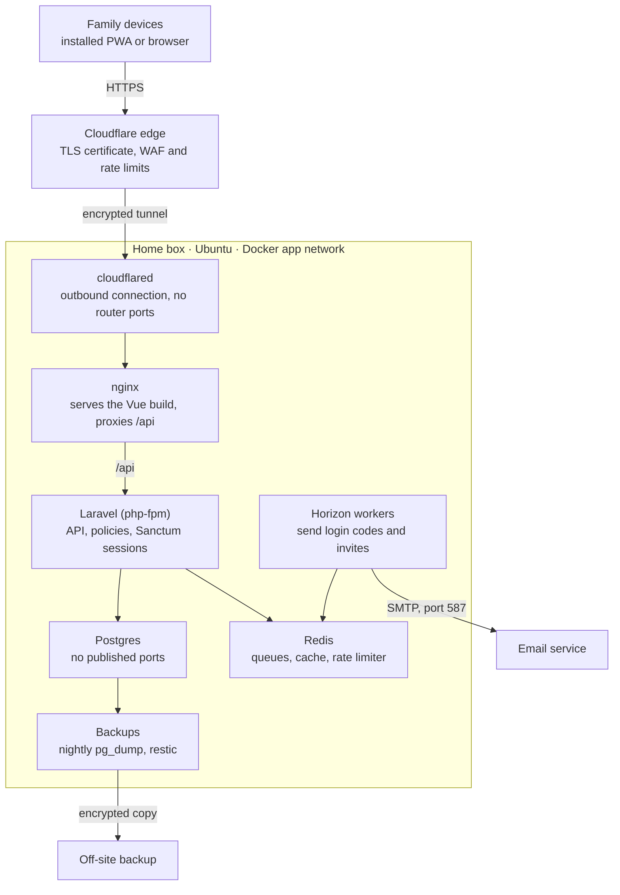

# Personal Tools PWA — Implementation Plan

Nov 4, 2026 · Kameron

## Overview & goals

One self-hosted, installable web app that hosts personal tools and shares some of them with family. The first deliverable is a gift tracker live before the holidays; lists, recipes and finance follow.

**Tools planned**

- Gift tracker: shared wishlists where family claim gifts without the recipient seeing claims
- TODO and grocery lists, saved recipes
- Budget and finance tracker (private)

**Guiding principles**

- Simple for non-technical family: no passwords, invite-only, install from a link
- Public but locked down: no open router ports, invite-only access, secrecy rules enforced server-side
- One deployment, many groups: siblings get their own isolated spaces rather than separate instances

## Architecture & stack

One Laravel API and Vue 3 SPA backed by PostgreSQL, run as a Docker Compose stack on the home box. It is a modular monolith with one module per tool: Gifts, Lists, Recipes, Finance.

Cloudflare terminates TLS and filters traffic; the tunnel is the only way in, and Postgres and Redis are reachable only inside the app network.

- **Backend:** Laravel with Sanctum, queues for mail (Laravel Horizon on Redis), scheduler for timed jobs.
- **Frontend:** Vue 3 SPA built with Vite, served as static assets from the same origin.
- **Database:** PostgreSQL, no published ports. Redis backs Horizon's queues, the cache and the rate limiter, also with no published ports.
- **Web server:** nginx + php-fpm.
- **Code style:** Pint for PHP (Laravel default preset), Prettier for Vue, JS and CSS.

## Hosting & networking

The app runs on the always-on home box (Ubuntu 24, moving to 26) and reaches the internet only through a Cloudflare Tunnel. No new router ports are opened; the existing Minecraft forward stays the only inbound exposure.

- **Cloudflare Tunnel:** a `cloudflared` container makes an outbound connection to Cloudflare. Home IP stays hidden and it works behind CGNAT.
- **TLS:** Cloudflare issues and renews the public certificate automatically. No Let's Encrypt setup on the box.
- **Hostname:** the subdomain `app.network-kam.com` routes to the tunnel.
- **Laravel:** TrustProxies configured for Cloudflare headers so URLs and client IPs are correct.
- **Isolation:** the app gets its own Docker network, separate from the Minecraft server.

**Exposure split by sensitivity**

| Area | Reachable from | Why |
| --- | --- | --- |
| Gifts, lists, recipes | Public, via tunnel | Family need access from anywhere |
| Finance | Tailnet only, or Cloudflare Access | Highest-sensitivity data |
| Admin tools | Tailnet only, or Cloudflare Access | Only you need them |

## Authentication & sessions

Passwordless sign-in: the user enters their email and receives a link plus a 6-digit code. The inbox is the credential, so every emailed secret is short-lived, single-use and stored only as a hash.

**Sanctum SPA cookie auth**

- Single origin: Laravel serves `/api` and the built Vue assets from one domain. No CORS, no tokens in localStorage.
- CSRF: Vue calls `/sanctum/csrf-cookie`; Axios echoes the `XSRF-TOKEN` back on each request.
- Session cookie: `httpOnly`, `Secure`, `SameSite=Lax`.
- `session()->regenerate()` on login to prevent session fixation.
- Sessions stored in Postgres (database driver) so they can be listed and revoked.

**Sign-in flow**

1. User submits their email.
2. Server generates a random token and a 6-digit code, and stores only their SHA-256 hashes with an expiry (link ~15 min, code ~10 min).
3. Response is always "if that account exists, we sent a code" to prevent account enumeration.
4. The link opens a page with a **Sign in** button that POSTs, so email link scanners can't consume the token with a GET.
5. On success: hash, look up, check expiry, delete (single-use), create the session.
6. Codes allow 5 attempts maximum. Requests are rate-limited per email and per IP in Laravel and Cloudflare.

**Why both a link and a code:** on iOS an installed PWA has separate cookie storage from Safari. Tapping the link signs in Safari, not the home-screen app, so phone users type the code into the app instead.

**Session policy**

- Long sliding sessions (~90 days) so family rarely re-authenticate.
- A "Your devices" page with "sign out everywhere" as the recovery tool for a lost phone.
- Passkeys as a later enhancement.

## Identity & sharing model

A login is not a person. Logins receive codes; profiles own data; groups scope what is shared. This split is built in phase 2, before family data exists.

| Entity | What it is | Key fields / relations |
| --- | --- | --- |
| Login | An email address that receives codes; owns no data | email; many profiles via `login_profile` |
| Profile | A real person: owns wishlists, claims, recipes | name; optional PIN; managers via `profile_managers` |
| Group | A set of profiles: Family, a household | type; members via `memberships` with a role |
| Membership | A profile's role in a group | owner, member, manager |
| Share | Grants a group access to an owned item | `shareable_type`, `shareable_id`, `group_id`, permission (view / edit) |

**Cases this covers**

- **Parents sharing one email:** one login, two profiles. After the code, a "Who's using this?" picker sets the active profile in the session. A shared inbox means either can switch profiles; an optional 4-digit profile PIN is a light deterrent.
- **Brother managed by Mom:** a managed profile with no login. Mom is listed in `profile_managers` and switches into it from her picker. If he gets an email later, a login is attached to his existing profile.
- **Sharing recipes:** recipes stay owned by your profile and are shared to groups through the Share table, read-only or editable per group.
- **Siblings' own lists:** each sibling gets a household group in the same deployment. Lists belong to a group, so households are isolated by the same policies. A group switcher handles people in several groups.

**The gift secrecy rule**

Claims on a wishlist are hidden only when the *active profile* is the list's recipient. Managers see claims on lists they manage. Enforced in Laravel policies and API resources, never only in the Vue UI.

## Invites

No public signup. People join through an email invite or an expiring group link, and every account still ends with a verified email.

**Email invite:** an admin creates an invite for an email and a group. The link carries a single-use hashed token; accepting it creates the login and profile and signs the person in.

**Group invite link (for WhatsApp)**

1. In a group, create a link with an expiry (e.g. 7 days) and an optional max-uses limit.
2. Share `app.network-kam.com/join/{token}` in the chat.
3. The person enters their name and email, then verifies with the 6-digit code.
4. With approval on, they land as pending until you approve; otherwise they join directly.

**Guardrails**

- Expiry, max uses and one-tap revoke.
- Approval required for the Family gift group.
- You're notified of every join or join request.
- A link only grants the member role in one group; never admin or manager, never other groups.
- The `/join` page's GET has no side effects, so WhatsApp's preview fetch is harmless. Open Graph tags stay generic and don't name the group or its members.
- An already-registered email still needs the code from that inbox, so only its owner can attach a new profile to it.

**Table:** `group_invites` (`group_id`, `token_hash`, `expires_at`, `max_uses`, `use_count`, `requires_approval`, `revoked_at`, `created_by`).

## Email

No self-hosted mail server: residential ISPs block port 25 and home IPs land on spam blocklists. Sending goes through a hosted service; receiving forwards to an existing inbox.

**Sending (login codes, invites, notifications)**

| Option | Pros | Cons |
| --- | --- | --- |
| [Cloudflare Email Sending](https://developers.cloudflare.com/email-service/) | Same dashboard as the domain; onboarding adds the DNS records; SMTP supported, so Laravel works as-is | Public beta since April 2026; needs the Workers paid plan; transactional only |
| Transactional provider (Postmark, Resend, Amazon SES) | Mature and widely documented; free tiers typically cover family scale | Another account; DNS records pasted in by hand |

Laravel config is `.env` only: `MAIL_MAILER=smtp`, the provider's host, port 587, credentials.

Send from a subdomain, e.g. `noreply@mail.network-kam.com`, to keep sending reputation separate from personal mail.

**Receiving**

- Cloudflare Email Routing (free) forwards addresses like `admin@` to your existing Gmail. Cloudflare adds the MX records.
- No mailbox or login exists at Cloudflare; mail is read in Gmail.
- To reply as the domain, add it under Gmail "Send mail as" using the same SMTP service.
- A hosted mailbox (Fastmail, Zoho, Proton, Google Workspace, Microsoft 365) is only needed if the domain becomes a personal email identity.

**DNS records**

| Record | Where | Purpose |
| --- | --- | --- |
| MX | Root domain | Where inbound mail is delivered (set by Email Routing) |
| SPF (TXT) | Root or sending subdomain | Which services may send; exactly one SPF record per name |
| DKIM (TXT) | Provider's selector subdomain | Public key that verifies message signatures |
| DMARC (TXT) | `_dmarc` | Policy on failures: start `p=none`, tighten to `p=quarantine` once passing |

## Security baseline & backups

Defense in layers: Cloudflare filters traffic before it reaches the box, Laravel enforces access per request, and backups cover the rest.

**Edge (Cloudflare)**

- WAF enabled.
- Rate-limit rules on login, code-verify and join routes.

**Application (Laravel)**

- Throttling on auth endpoints (Redis-backed rate limiter), matching the Cloudflare rules.
- Group scoping and the gift secrecy rule enforced in policies and API resources.
- Encrypted casts for sensitive finance fields.
- Secure, httpOnly, SameSite cookies and a Content Security Policy header.

**Host & containers**

- Postgres and Redis publish no ports; only the app network reaches them.
- Secrets in `.env`, never committed.
- Regular updates to base images, Composer and npm dependencies, and the Ubuntu host.

**Backups**

- Nightly `pg_dump`, encrypted and copied off-site (restic is a good fit).
- Restore tested once before family data goes in, then periodically.

## PWA & install experience

Family install the app from a link, with a short illustrated guide per platform. No app store involved.

- **Tooling:** `vite-plugin-pwa` for the manifest and service worker.
- **Caching:** app shell cached; API calls network-first. Offline grocery lists are a later upgrade.
- **Android:** the browser offers an install prompt.
- **iOS:** Safari → Share → Add to Home Screen. Push notifications only work once installed.
- **Sign-in on phones:** the 6-digit code path, because of the iOS cookie split (see Authentication).
- **"How to install" page:** screenshots for iPhone, Android and desktop, linked from invite emails and the join page.

## Phased roadmap

The gift tracker ships by mid-to-late November; everything after it follows without fixed dates. Each phase ends at a concrete "done when" check.

1. **Skeleton** (target: weekend of Nov 7–8)
   - Compose stack, tunnel, subdomain, email DNS.
   - Done when: a hello page loads over HTTPS from a phone on cellular, and a test email arrives in the inbox (not spam).
2. **Foundation**
   - Sign-in (link + code), sessions and devices page, logins/profiles/groups, profile picker, managed profiles, email and link invites, installable PWA shell, backups.
   - Done when: a test relative joins from a WhatsApp link, installs the app on an iPhone, and signs in with a code.
3. **Gift tracker MVP** (target: mid-to-late November)
   - Wishlists, claim and unclaim, optional "purchased" status, secrecy rule.
   - Done when: automated tests prove a recipient can never see claims on their own list via the API.
4. **Lists, groceries & recipes**
   - Household groups, Share table, recipe sharing to Family.
5. **Finance**
   - Tailnet-only or behind Cloudflare Access; encrypted fields.

## Open questions

- [ ] Sending service: Cloudflare Email Sending (beta, Workers paid) or a transactional provider?
- [ ] Finance access: Tailnet-only or Cloudflare Access?
- [ ] Off-site backup destination for restic.
- [ ] Confirm the subdomain `app.network-kam.com`.
- [ ] Plan for the Ubuntu 24 → 26 host upgrade without downtime during the holidays.
